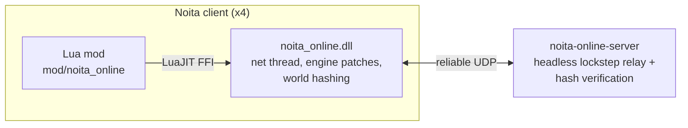

# Noita Online

Online multiplayer for [Noita](https://noitagame.com/) (Steam build of 2025-01-25) for 4+
players: a headless server and a client mod, talking over a custom reliable-UDP protocol.

Everything in the game is synchronised (players, wands, spells, enemies, items, physics,
and every pixel of the falling-sand world) because every client runs the *same*
simulation: the mod turns Noita into a **deterministic lockstep** game. Only player inputs
travel over the network; each client applies all players' inputs for frame *f* before
simulating frame *f*, and in-memory engine patches make Noita's simulation
bit-reproducible. In tests, clients report world hashes, which the server cross-checks
(`NOITA_ONLINE_VERIFY=1`, set by the test harness; off in normal play).



## Components

| Path | What |
|---|---|
| `crates/rudp` | Reliable UDP transport: connection handshake (challenge/response), acks with 32-bit history, per-channel reliable-ordered delivery with resends, fragmentation/reassembly, unreliable channel, RTT, timeouts, loss/latency simulator. |
| `crates/protocol` | Game messages and the redundant lockstep input/tick streams. |
| `crates/server` | Headless server (`noita-online-server`): lobby, lockstep tick relay, auto input delay, cross-client hash verification, bandwidth/CPU metrics. Linux and Windows. |
| `crates/client` | `noita_online.dll` (32-bit Windows, loaded inside Noita on Windows and under Proton on Linux): network thread, determinism patches, world hashing, frame timing. |
| `crates/simclient` | Headless fake clients for load/relay tests without Noita. |
| `mod/noita_online` | The Noita mod (Lua). |
| `harness/` | Build, launch, end-to-end test and evaluation scripts. |
| `docs/` | Design notes: [architecture](docs/architecture.md), [determinism patches](docs/determinism.md), [testing](docs/testing.md). |

## Build

Requirements: Rust (stable) with targets `i686-pc-windows-gnu` and `x86_64-pc-windows-gnu`,
and the MinGW cross toolchains (`i686-w64-mingw32-gcc`, `x86_64-w64-mingw32-gcc`).

```sh
rustup target add i686-pc-windows-gnu x86_64-pc-windows-gnu
harness/build.sh
```

Outputs: `target/release/noita-online-server` (Linux),
`target/x86_64-pc-windows-gnu/release/noita-online-server.exe` (Windows), and
`mod/noita_online/bin/noita_online.dll` (the client runtime, copied into the mod).

## Play

1. **Server** (any machine reachable by all players, UDP port 41773 by default):
   ```sh
   noita-online-server --players 4            # starts the session once 4 players joined
   ```
   Useful options: `--bind 0.0.0.0:41773`, `--seed N`, `--input-delay N|auto`,
   `--log-dir DIR` (writes `summary.json`, `hashes.jsonl`, `net.jsonl`, `perf.jsonl`).
2. **Clients**: copy `mod/noita_online` (including `bin/noita_online.dll`) into
   `Noita/mods/`, enable it in the Mods menu and allow unsafe mods (the mod needs
   `request_no_api_restrictions` for its native runtime). In the mod settings enter the
   server address (`host:port`) and your name, then start a **New Game**. The game waits
   at start until all players joined; then everyone plays the same world.

All players must run the same Noita build (2025-01-25) and the same set of mods; the server
rejects mismatches.

**Whose progress**: Noita builds the world partly from your save (spell, perk and secret
unlocks, the intro, orbs collected over all runs, your death count, the bones wands
apparitions carry). A session plays with the **host's** progress, the first player's (the
first to join the server), on every client. What you earn during the session (a new
unlock, an orb, your deaths) is still saved to **your own** save, as in vanilla; the host's
progress is never written to it.

Every player wears their own robe colour (body, arm and cape, also with the Lukki
mutation), the same on every screen, by the player's place in the session: the first player
keeps Noita's purple, then red, green, blue, yellow, orange, cyan, pink and white (a session
of more than 9 players repeats them from red).

## Death and respawn

- **Death is vanilla's**: a player whose HP reaches 0 dies as in single player: death
  effects and sound, and a ragdoll in that player's robe colour that stays in the world and
  is seen by everyone. The dying player sees vanilla's game-over screen with the cause of
  death and the run's stats; the others see "*name* died".
- **Respawn**: while another player lives, the game-over screen's **New game** button reads
  **Respawn**; it opens a list of the living players (in their robe colours), and the player
  respawns beside the one picked, at full HP, with the perks, wands, spells and items it
  died with, minus a penalty: half its gold (`--respawn-gold-loss 0.5`, rounded down) and one
  random quick-inventory item, destroyed (`--respawn-item-loss 1`; never the last wand).
  It is told what it lost; the others see "*name* respawned at *other*". A player who dies
  polymorphed respawns as the player the polymorph kept.
- **Game over for everyone**: when every player is dead at the same time, each sees vanilla's
  game-over screen with its **New game**; once every player pressed it the session starts its
  next run, a new world (new seed) in which all players spawn together as at the session
  start (the others keep seeing the old world until then).

## Test

See [docs/testing.md](docs/testing.md). In short:

```sh
cargo test --release --workspace          # unit + integration tests (incl. reliable UDP)
harness/sim_test.sh 4 1800 loss=0.05,latency=100   # server + 4 headless bots
# inside a desktop session (launches Noita instances):
harness/e2e.sh --pin --players 4 --frames 36000 --out run/e2e/full
harness/e2e.sh --pin --solo --players 4 --frames 36000 --out run/e2e/baseline
harness/e2e.sh --pin --players 4 --frames 36000 --netsim loss=0.05,latency=100 --out run/e2e/netsim
harness/evaluate.py --run run/e2e/full --baseline run/e2e/baseline --netsim-run run/e2e/netsim
```

## Limitations

The goal is the base game's behaviour; these are the deviations multiplayer forces.

- Lockstep: a session starts with all players present; players cannot join mid-session.
  A player who leaves stays in the world as a motionless player (neutral input) instead of
  ending the run for everyone; it no longer counts for the all-dead game over. Starting a
  new game from the pause menu during a run ends that client's session (restart Noita to
  join another).
- Death and respawn (see *Death and respawn*) add to vanilla's death:
  - the respawn picker is the mod's own overlay (a list of the living players), opened from
    vanilla's game-over button relabelled "Respawn"; vanilla has no respawn;
  - a player dies one frame after its fatal hit (it is held at 0 HP for a frame so every
    client can store it for the respawn first); the cause of death, the killer and the
    ragdoll's impulse are the fatal hit's, as in vanilla;
  - no "bones" wand is saved for later runs on death (that path writes a save file and
    draws from the shared RNG);
  - the game-over screen's stats are this client's stats for the run, not strictly the dead
    player's own;
  - during a session the all-time `death_count` the game reads is the host's (world
    generation reads it); each player's own deaths are added to its own save's count when
    Noita saves it (at exit).
- Input latency: your inputs take effect after the session's input delay, the frames an
  input needs to reach every client: 1 frame (17 ms) on a LAN, about the round trip over the
  internet; the server adapts it to the network during the session. Inventory GUI actions
  (number keys, the inventory screen) take one frame more.
- Noita's own inventory GUI (HUD, quick bar, inventory screen, pickup prompts) runs for
  each player on their own client; its edits travel through lockstep, so they take effect
  after the input delay. The inventory screen and the full-inventory "replace which item"
  screen do not pause the world for the other players (your character stands still while
  one is open).
- Pausing (escape menu) stalls every client: lockstep advances only with all inputs.
- Players can kick each other. Noita treats a kicked player like any kicked creature that
  carries items: besides the push and the kick damage, it throws every wand and item out of
  its inventory (only wand ghosts are immune). Single-player Noita has no second kicker, so
  this only happens with several players; the engine's rule is kept.
- Camera-relative engine behaviour (on-screen particles, rain, CameraBound enemies, AI
  hunting, fog of war, screen shake, chunk loading) is evaluated around every player's view:
  the camera that player's own client rendered, sent with its input, so it lags that
  player's screen by the input delay plus one frame (2 frames on a LAN). Weather and music
  follow the first player. Markers the engine draws into the world (telepathy, radar) are
  seen by every player.
- One player's world-changing events (fungal shift, explosions, positional sounds) are
  shared, as the world is; only their messages are shown to that player alone.
- The in-game date (holiday content, weather changes on the hour) is the server's session
  clock in UTC, the same for every player.
- Every client simulates every player, so a client's CPU load grows with the player count.
- Gamepad paths (stick aim, analog flying, camera look-ahead, rumble) are implemented but
  untested: the test machine has no gamepad.
- Only the Noita build of 2025-01-25 (PE timestamp `0x6794ee3c`) is supported; the
  runtime verifies every patched instruction and refuses to run on another build.
