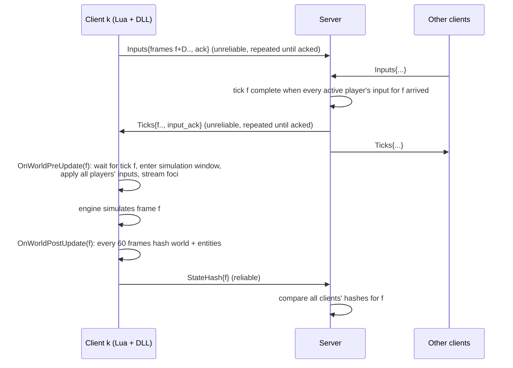

# Architecture

## Why lockstep

Noita simulates every pixel of its world (falling sand, liquids, gases, fire), rigid bodies
(Box2D) and thousands of entities. Replicating that state over the network would cost far
more than any home connection allows and could never make clients *exactly* equal.
Noita Online instead makes every client run the identical simulation from identical
inputs (deterministic lockstep). The network carries only player inputs (~23 bytes per
player per frame) plus verification hashes.

## Frame loop

* **Input delay** `D` frames hides the round trip (client → server → clients). The server
  derives it from measured RTT at session start (`--input-delay auto`).
* **Redundant streams**: each client datagram repeats all inputs the server has not
  acknowledged; each server datagram repeats all ticks the client has not acknowledged. A
  lost datagram costs one frame interval, not a resend round trip, and there is no
  head-of-line blocking. Session control, state hashes and logs use the reliable channel.
* A client that cannot get tick *f* blocks in `OnWorldPreUpdate` (the game pauses); all
  clients therefore stay on the same frame within `D`.

## Transport (crates/rudp)

* Handshake: `ConnectRequest(client_salt, name)` → `Challenge(client_salt, server_salt)` →
  `ChallengeResponse(token = client_salt ^ server_salt)` → `Accepted(token, id)`. Requests are
  padded so replies are never larger (no amplification). Data packets carry the token.
* Packet header: kind, token, 16-bit sequence, ack, 32-bit ack history (every packet acks up
  to 33 packets).
* Reliable-ordered channels: 16-bit message ids, windowed send buffer, resend after
  `max(rtt + 4·rttvar, 20 ms)` until a packet carrying the message is acked, in-order
  delivery, fragmentation of large messages into MTU-sized pieces reassembled on receipt.
* Unreliable channel: single-datagram messages.
* Timeout after 10 s of silence; keepalives every 100 ms.
* `LinkConditions` injects loss/latency/jitter/duplication on both directions of an
  endpoint (`--netsim`), used by tests and by the network-conditions acceptance run.

## Client (mod + DLL)

* `init.lua` runs when a new game starts: installs the determinism patches, connects,
  waits for the session start (seed, player list, input delay), sets `WORLD_SEED` and the
  lockstep magic numbers.
* **Player slots**: every client creates one player entity per session slot at the same
  frame, in the same order, so all entity ids match. Slots are driven only by tick inputs
  (their `ControlsComponent` is disabled and written by the mod). The engine's own spawned
  player becomes an inert *input proxy*: Noita's input system keeps writing this client's
  keyboard/mouse/gamepad state into it, the mod reads it and sends it to the server.
* **Simulation window**: between `OnWorldPreUpdate` and `OnWorldPostUpdate` the engine
  RNGs run on a shared "simulation" stream and the camera is set to an identical
  simulation position; outside the window (rendering, GUI) each client uses its own RNG
  stream and its own camera following its own player.
* **Foci**: chunks are loaded and simulated around every player (identically on every
  client) instead of around each client's own camera; a deterministic unloader replaces
  the engine's wall-clock one.
* Deaths do not end the run: a player at 0 HP becomes an invulnerable spectator.

## Server

* Lobby until `--players` clients said hello (same protocol version, game build and mod
  list), then `Start{seed, players, input_delay, params}`.
* Lockstep relay: per frame, one tick containing every active player's input, emitted in
  order once complete; departed players are dropped from subsequent ticks.
* Verification: per checkpoint frame, every chunk loaded on ≥ 2 clients and every tracked
  entity position (players, enemies) is compared exactly; results go to `hashes.jsonl`
  and `summary.json`.
* Metrics: per-client bandwidth (1 s windows), process CPU time, client frame-time
  reports.
