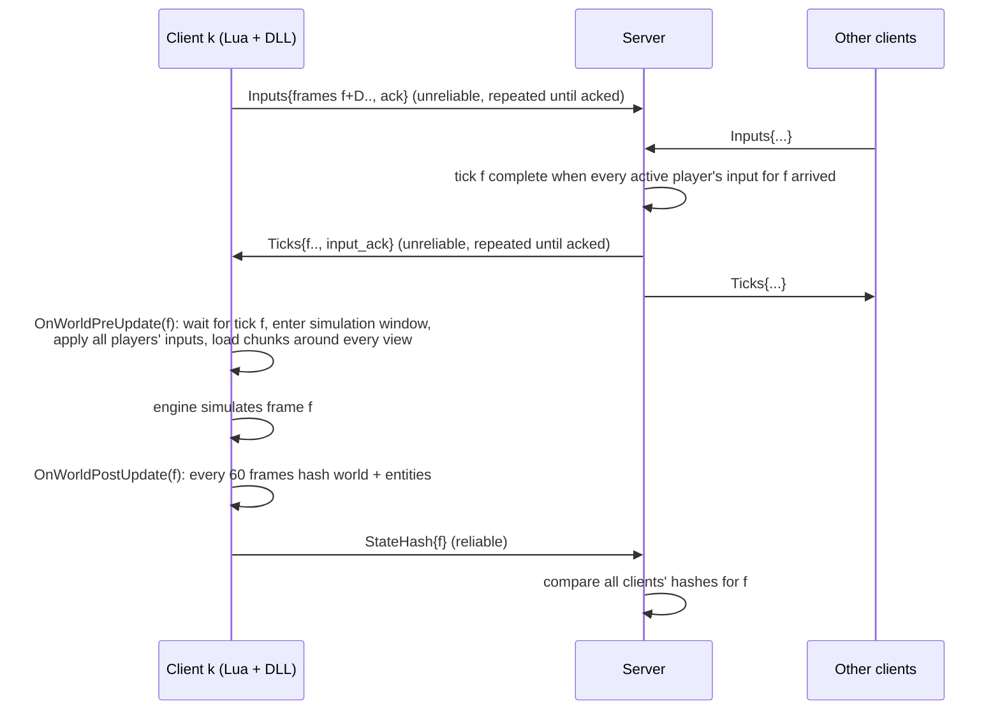

# Architecture

## Why lockstep

Noita simulates every pixel of its world (falling sand, liquids, gases, fire), rigid bodies
(Box2D) and thousands of entities. Replicating that state over the network would cost far
more than any home connection allows and could never make clients *exactly* equal.
Noita Online instead makes every client run the identical simulation from identical
inputs (deterministic lockstep). The network carries only player inputs (~23 bytes per
player per frame) plus verification hashes.

## Frame loop



* **Input delay** `D` frames hides the input's trip client → server → clients: the input a
  client captures while simulating frame *f* is simulated by every client in frame *f + D*.
  The server starts the session with the fewest frames that cover the slowest link's lobby
  round trip plus 2 ms at 60 fps (1 frame on a LAN, `--input-delay auto`) and then adapts
  it to what the network needs at the session's actual frame rate. The clients report, per
  ~60 frames, their frame time, how long and on how many frames they waited for their tick,
  and their latest ping round trip. The network bound is the worst client round trip
  (smallest of its last 3 reports) + 25 % + 2 ms, in frames of the session's pace (the
  slowest client's frame time without tick waits), plus one frame when the server sees ≥ 1 %
  of its packets to a client go unacknowledged over the last 8 rounds (a lost datagram costs
  one frame interval, see below). When even the client that waited least waited for 3+
  ticks and `D` is below the bound, `D` grows by one frame. At or above the bound the inputs
  arrive in time, so waits are frame pacing (in lockstep a client waits whenever another
  runs a frame behind, whatever `D`; 4 clients on one machine stall on ~15 % of frames at
  `D` = 1, 2, 3 and 4 alike) and do not raise it. After 3 consecutive rounds above the
  bound, `D` shrinks by one, never below 1; each change is followed by 2 ignored rounds. The
  server announces the new value (`InputDelay`); a client switching to a longer delay sends
  its current input for one more frame (held buttons only), one switching to a shorter
  delay merges two frames' inputs into one (buttons pressed in either, both frames' wheel
  steps and inventory edits). Switches cannot desync: every client simulates the ticks the
  server relays.
* **Redundant streams**: each client datagram repeats all inputs the server has not
  acknowledged; each server datagram repeats all ticks the client has not acknowledged. A
  lost datagram costs one frame interval, not a resend round trip, and there is no
  head-of-line blocking. Session control, state hashes and logs use the reliable channel.
  The client acknowledges ticks with its next input; the server repeats the stream on its
  own only after 50 ms without a new tick for a client that lacks ticks.
* A client that cannot get tick *f* blocks in `OnWorldPreUpdate` (the game pauses); all
  clients therefore stay on the same frame within `D`.

## Transport (crates/rudp)

* Handshake: `ConnectRequest(client_salt, name)` → `Challenge(client_salt, server_salt)` →
  `ChallengeResponse(token = client_salt ^ server_salt)` → `Accepted(token, id)`. Requests are
  padded so replies are never larger (no amplification). Data packets carry the token.
* Packet header: kind, token, 16-bit sequence, ack, 32-bit ack history (every packet acks up
  to 33 packets). A packet carrying messages is acked by the receiver's next packet, sent
  at once if nothing else is due; message-less packets (acks, keepalives) are not acked.
* Reliable-ordered channels: 16-bit message ids, windowed send buffer, resend after
  `max(rtt + 4·rttvar, 20 ms)` (the game client: 100 ms) until a packet carrying the message
  is acked, in-order delivery, fragmentation of large messages into MTU-sized pieces
  reassembled on receipt.
* Unreliable channel: single-datagram messages.
* Timeout after 10 s of silence; keepalives every 100 ms.
* `LinkConditions` injects loss/latency/jitter/duplication on both directions of an
  endpoint (`--netsim`), used by tests and by the network-conditions acceptance run.

## Client (mod + DLL)

* `init.lua` runs when a new game starts: installs the determinism patches, connects,
  waits for the session start (seed, player list, input delay), sets `WORLD_SEED` and the
  lockstep magic numbers.
* **Player slots**: every client creates one player entity per session slot at the same
  frame, in the same order, so all entity ids match. Slots are driven only by tick inputs
  (their `ControlsComponent` is disabled and written by the mod). The engine's own spawned
  player becomes an inert *input proxy*: Noita's input system keeps writing this client's
  keyboard/mouse/gamepad state into it, the mod reads it and sends it to the server. The
  engine writes it during the world update; the client runtime runs that write for the
  proxy just before `OnWorldPreUpdate` instead (`early_input`), so the capture in
  `OnWorldPreUpdate` gets the input the engine polled for this frame, as vanilla's player
  uses it in this frame's update, with the mouse mapped through this client's render camera.
* **Simulation window**: between `OnWorldPreUpdate` and `OnWorldPostUpdate` the engine
  RNGs run on a shared "simulation" stream and the camera is set to an identical
  simulation position; outside the window (rendering, GUI) each client uses its own RNG
  stream and its own camera following its own player.
* **Foci**: chunks are loaded around every player's view (vanilla's camera loads, per
  player) and simulated around every player (identically on every client) instead of around
  each client's own camera; a deterministic eviction replaces the engine's wall-clock one
  (vanilla's rule, applied per player).
* **Deaths and respawn** (`files/players.lua`, `crates/client/src/respawn.rs`), all inside
  the window and identical on every client unless noted:
  - a slot whose HP reached 0 is held there for one frame (`wait_for_kill_flag_on_death`);
    in the next tick every client stores it with the engine's own entity serializer (the
    one polymorph uses; a player that dies polymorphed is the record its polymorph keeps)
    and sets `kill_now`: vanilla's death (effects, sound, robe-coloured ragdoll that stays).
    `death_cause` replays the fatal hit's KillMe for that deferred death, so the cause, the
    killer and the ragdoll's impulse are the hit's;
  - the dead player's own client finishes its game-over stats in its death (GameStatsSystem's
    PlayerDied handler, which writes only the stats nothing in the simulation reads, keeping
    `death_count`) and, after the window, calls vanilla's `GameTriggerGameOver`; the game
    mode's game-over flag is swapped at the window edges (`respawn::sim_enter` /
    `sim_leave`), so the simulation sees the shared value (set only when every player is
    dead) and the menu this client's own;
  - `game_over_respawn`: while another player lives, the game-over button reads "Respawn"
    and only records the click; the mod's picker (`files/respawn_picker.lua`) lists the
    living players, and the choice is a lockstep input op (`RESPAWN_OP`, target id). In the
    tick that carries it every client loads the stored player at the target, at full HP,
    and applies the penalty (Start params `respawn_gold_loss`, `respawn_item_loss`; the
    lost item is drawn from the session seed, frame and player, not an engine RNG);
  - when every player is dead at once the run is over: see *Runs* below.
* **Robe colours** (`files/robes.lua`): during mod init, once the session's player list is
  known, every slot after the first gets virtual copies (`mods/noita_online/robes/<k>/`) of
  the player entity, its robe sprites (body, Lukki body, arm, the unlockable hat's two
  sprites) and ragdoll images with the robe's three purple shades recoloured (alpha, skin,
  belt and outlines unchanged), the cape's colours set as an override in the cape's Base,
  and the sprites' stain UV maps copied to the paths the engine derives from the new image
  paths (`data/generated/sprite_uv_maps/` + path with `/` → `.`). Slot k is loaded from its
  copy. Purely visual: shapes, stains, ragdoll bodies and cape physics stay vanilla's.
* **Off the game thread**: during the session the network thread sends once per frame,
  when the game queues its input: one packet with the input stream, the acks and the
  queued messages (state report, logs). Datagrams wake it at once (ticks are in the
  stream before the game asks for them); while the game runs, such a wake only receives,
  its acks go out with the next input. Transport timers wake it too. State-report chunk
  hashes are computed on a worker thread started at the client's buffer swap (the game
  thread waits on the driver there and the pool workers are idle); cells only change inside
  the window, and the next window entry waits for the worker.

## Runs (game over for everyone, then a new world)

A session is a series of runs, each a world with its own seed and frames counting from 0.

```mermaid
sequenceDiagram
  participant A as Client A
  participant S as Server
  participant B as Client B
  Note over A,B: frame f of run n: every player is dead (inside the window, every client)
  A->>A: NextRun.all_dead(f): run over; vanilla's game over screen
  B->>B: same
  A->>A: New game: the main loop ends, the old world is torn down, init.lua runs again
  A->>S: NextRun{n+1} (after its last state report of run n)
  S->>S: A leaves run n (its ticks no longer wait for or carry A)
  S->>B: Ticks of run n (B still simulates the old world)
  B->>B: New game ...
  B->>S: NextRun{n+1}
  S->>A: Start{run n+1, new seed, same roster}
  S->>B: Start{run n+1, ...}
```

* Vanilla's new game restarts the game in place: the game-over menu's "New game" opens the
  game-mode screen (`FUN_006ceb00`, which loads the modes); picking a mode with the game over
  set calls `FUN_006cc030`, which starts a fade; when the fade ends the game mode's restart
  request is set, and the end of that frame's world update (`FUN_006b59d0` →
  `FUN_006af010` → `FUN_006e9f30`) tears the world, entities, Box2D and the mods' Lua states
  down and rebuilds them, running every mod's `init.lua` again. GameGlobal (`[0x0122374c]`)
  and the engine's other statics stay, and so does the client runtime (the DLL with its
  connection, network thread and engine patches).
* `init.lua` on such a new game calls `no_next_run`: if the run is over (`no_run_over`, set
  by `NextRun.all_dead`) the runtime resets every per-world piece of its state as in a fresh
  process (`nextrun::reset_run`, see determinism.md) and sends `NextRun`; then the session
  start repeats (wait for `Start`, seed, magic numbers, player slots, robes). A new game
  while the run goes on (from the pause menu) leaves the session as before.
* Server: a client's `NextRun` takes it out of the run like a departed player, so the clients
  still on the game-over screen keep simulating the old world in lockstep (and are verified
  against each other); once every connected client is ready, the server starts the next run:
  the next seed (with `--seed S`: S for run 0, then a seed derived from S and the run index,
  so tests are reproducible; otherwise random), the same roster and parameters plus `run=n`,
  a fresh relay, the input delay carried over with a fresh adaptation. Lockstep datagrams
  carry their run index; one of another run is ignored. Verification keys reports by (run,
  frame); `hashes.jsonl` lines carry `run`, `summary.json` lists every run (seed, frames,
  verification totals) and the current one, `events.log` logs each client leaving a run and
  each run's start.

## Persistent progress (whose save)

Noita builds the world partly from the player's save: persistent flags (spell, perk and
secret unlocks, the intro), the orbs collected over all runs, the all-time `death_count` and
the bones wands apparitions carry (the readers: determinism.md, `progress`).
A session plays with the host's, the first player's (`crates/client/src/progress.rs`):

* `no_connect` snapshots this player's progress (`protocol::Progress`: flag and orb names,
  `death_count`, bones files) into `Hello.progress`; the server keeps each client's and sends
  the first player's in run 0's `Start.progress` (later runs' `Start` carries none: the
  clients keep the session's).
* `init.lua`, right after the session start (every run), calls `no_progress_apply`
  (`NO.progress_apply`): the engine's flag and orb sets become the host's, `death_count` the
  host's, and the host's bones files become virtual files (`mods/noita_online/session_bones/`)
  that the apparitions' bones list names. The new game's reloads of the flags and orbs from
  the save keep the session's sets.
* Writes still reach each player's own save, as in vanilla: every add or remove of a flag or
  orb runs the engine's own code against that player's own save's membership (it writes the
  flag file exactly when vanilla would for this save) and then updates the session's set:
  changes inside the simulation window (or before the run's first frame) are the session's,
  this client's own GUI's (outside the window) only its save's. The stats are saved with the
  player's own `death_count` plus its own deaths in the session. Leaving the session restores
  the player's own progress. The host's progress is never written to another save.

## Server

* Lobby until `--players` clients said hello (same protocol version, game build and mod
  list), then `Start{run 0, seed, players, input_delay, params, progress}`; each later run starts with
  its own `Start` once every client sent `NextRun` (see *Runs*).
* Lockstep relay: per frame, one tick containing every active player's input, emitted in
  order once complete; departed players are dropped from subsequent ticks. The server waits
  on its socket (at most 1 ms, for timers), so a datagram is relayed as soon as it arrives.
* Input delay: start value from the lobby round trips, then kept at the network's need at
  the session's frame rate (`delay.rs`, see above).
* Verification (testing only): clients started with `NOITA_ONLINE_VERIFY=1` (the test
  harness sets it; normal play doesn't, it costs ~1.5 % frame rate) send state reports.
  Per checkpoint frame, every chunk loaded on ≥ 2 clients and every tracked entity
  position (players, enemies) is compared exactly; results go to `hashes.jsonl` and
  `summary.json`. A mismatch is only logged (`events.log`); nothing is resynchronised.
* Metrics: per-client bandwidth (1 s windows), process CPU time, client frame-time
  reports.

## Input latency

From the frame whose input poll first sees a key press (vanilla's player reacts in that
frame's world update) to the update in which every client's copy of the player reacts:

| Stage | Frames |
|---|---|
| Noita polls input, then runs DeathMatch::Update; the ControlsSystem update of the input proxy runs before the `OnWorldPreUpdate` dispatch (`early_input`) | 0 |
| `OnWorldPreUpdate(f)`: the mod captures the proxy and queues the input for frame f + D; the network thread sends it at once | 0 |
| Server: tick f + D is complete when the last player's input for it arrived; sent at once | — |
| Clients: the tick arrives (network thread, at once); `OnWorldPreUpdate(f + D)` applies it to the player slots' ControlsComponents | D |
| The world update of frame f + D: the character walks, fires, ... | D |

So an input takes effect D frames after vanilla would apply it: 1 frame (17 ms at 60 fps) on
a LAN. Only Noita's inventory GUI (number keys, the inventory screen) takes one frame more:
it has to run after the world update (it draws the updated HUD), so its edits go out with
the next frame's input. `harness/latency.py` measures every stage from the
`NOITA_ONLINE_LATPROBE=1` probe log (vanilla: the same probe without a session).
